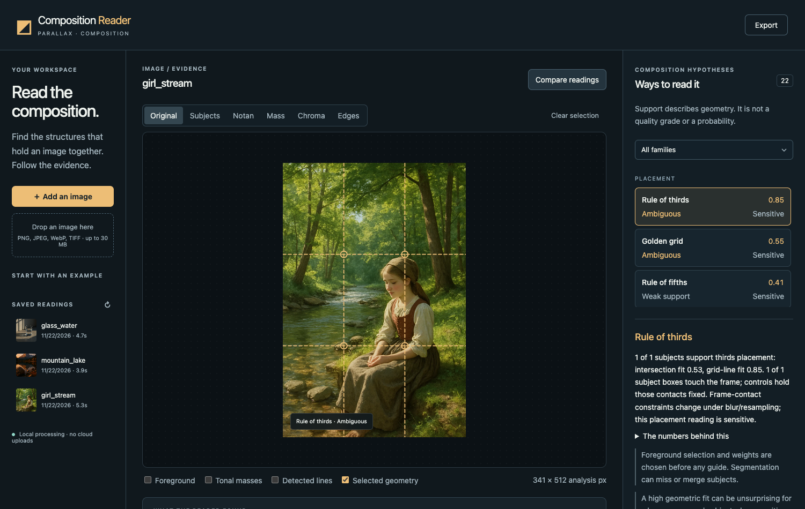
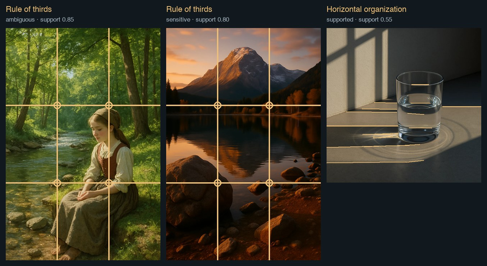
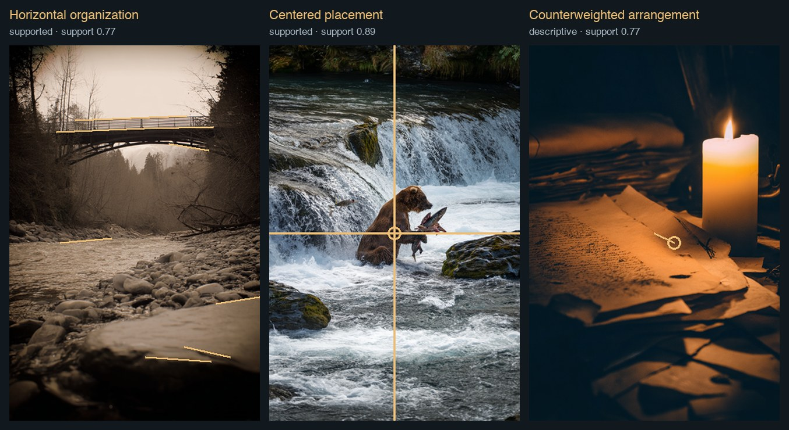
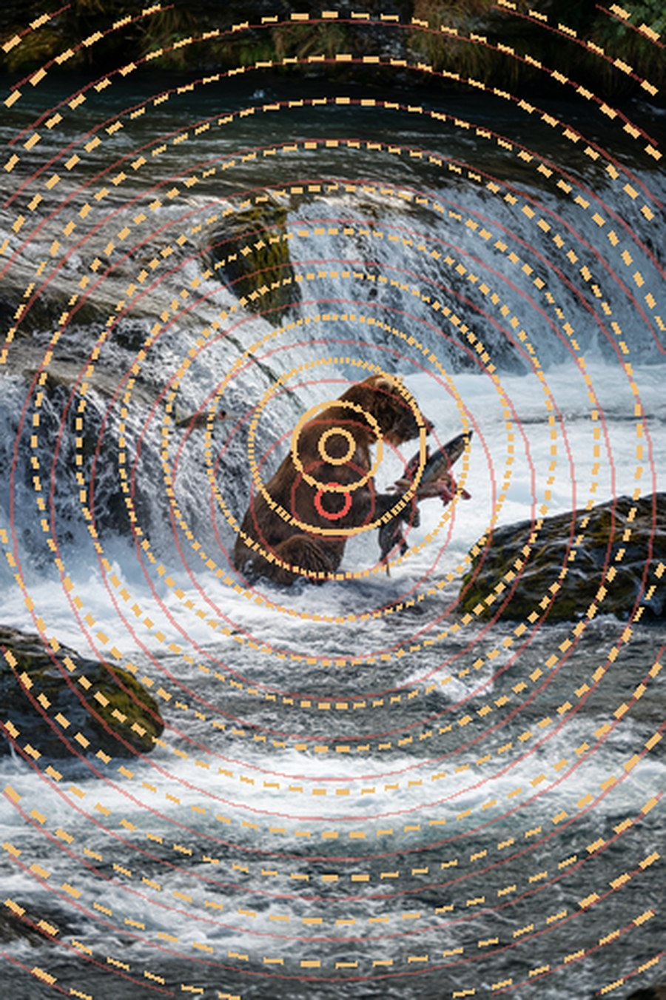
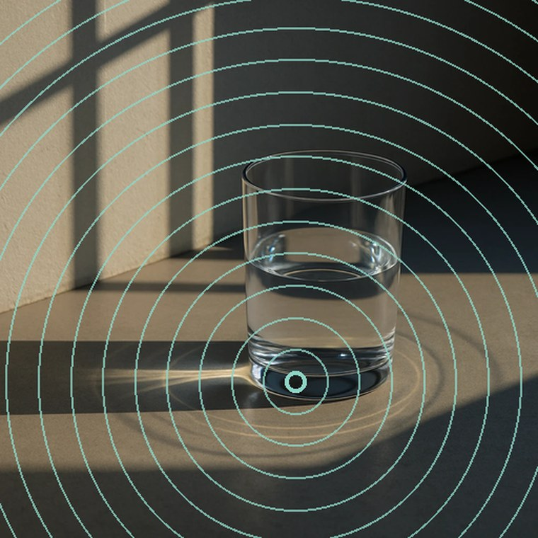
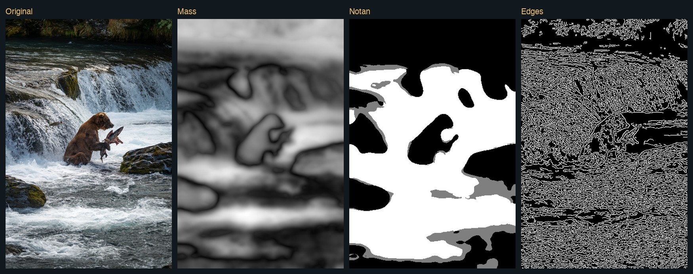
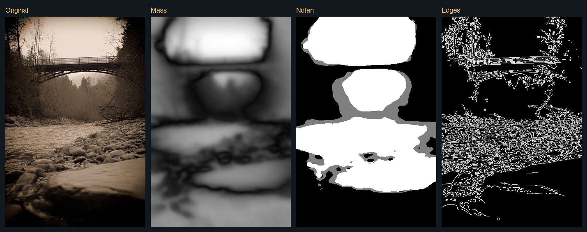

# Composition Reader

A workbench that reads an image's composition against named hypotheses (thirds, symmetry, radial organization with adjustable rings, armatures and more) and checks each reading under blur and resampling. Every reading reports what supports it and what would change it. It is an instrument for the eye, not a score of quality.

**Try it: https://composition-reader.up.railway.app/** The hosted version is a fuller build with additional features, including subject selection that is aware of faces and objects. Images are analysed on the server and deleted within an hour. This repository is the lighter core.



## What it looks like

Different images support different readings. Each panel shows the reading's drawn geometry, its status and its support value. The status says how the reading held up against its own controls and the blur and resampling checks.





The radial reading draws rings so the eye can judge where structure pulls. By default they are drawn around the frame centre (faint red) and the mass centre (dashed yellow).



You can also place your own centre and drag it. Here it was placed by hand on the ring of light under the glass. The reading itself does not detect this ring; the overlay is there for the eye.



The structure fields it reads from an image (original, mass, Notan values, edges):





Support values describe how well the geometry fits the measured structure. They are not quality scores, and a high value for one reading does not mean the others are wrong. All example images are AI-generated.

## Run

```sh
./run.sh
```

The first run creates a virtual environment, installs the package and downloads the foreground model (checksum-verified). It then serves the app and opens it in your browser. Everything stays on your machine.

To run the public-style server instead (per-browser readings, images and reports deleted after `COMPOSITION_RETENTION_MINUTES`, default 60):

```sh
python -m composition_reader.site
```

## Deploy on Railway

Deploy from the repository; `railway.json` selects the Dockerfile, which installs dependencies and fetches the model once. Health check: `/api/health`. Suggested size: 2 vCPU, 2 GB RAM. Analyses run one at a time per instance.

## What it reads

Placement (thirds, golden grid, fifths, centre cross, quadrants, diagonals, rabatment), armatures, direction, arrangement, symmetry, radial and circular organization, convergence, counterweighting and open field. Each hypothesis is measured from the image's foreground mass, edges and line segments. Where a randomized geometric control exists, the reading is compared with it; eight readings are descriptive only.

## Limits

- A generalist tool: it will not read every image right. Readings are descriptive, with stability checks, not verdicts.
- Placement readings (thirds and the other grids) score the whole foreground mass. There is no face, horizon or object-level subject selection in this build, so a face on a third is not treated specially.
- Ring detection finds edge rings; images that radiate through mass and light falloff show none. The drawn rings in "Radial organization" are a reference for the eye, not a detection.
- The one model, U²-NetP, has no model-specific licence record for its converted weights; see `docs/THIRD_PARTY.md`.

## Tests

```sh
pip install -e ".[dev]" && pytest
```

Known-answer tests cover the detectors, the rings, the service and the vendored-source hashes. Some tests need the downloaded model (`composition_reader.cli install-model`).

## Licence

MIT, see `LICENSE`. Vendored components keep their own MIT notices in `vendor/`; see `docs/THIRD_PARTY.md`.
